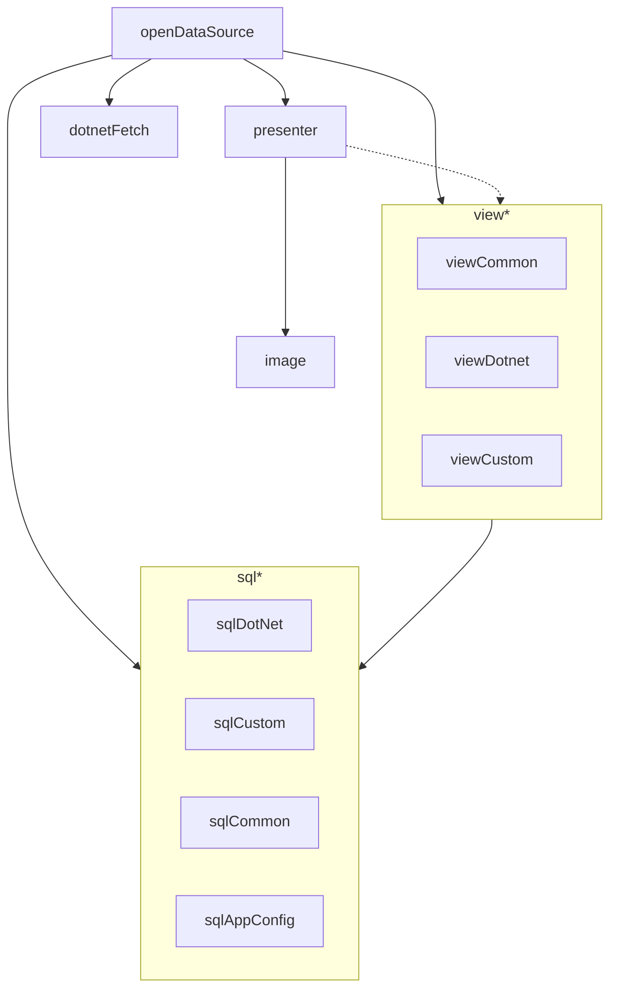

# Backend

The functional layers within the `backend` package: what each folder does, and how they depend on one another.
What the package shares with the front ends is `INTERFACES.md`.

## Storage

The tables the model lives in, and the stores that hold what changes as you work. Each is a SQLite database
through `sqlio`, and each folder here owns one kind of data.

| folder                                                      | its job                                                    |
| ----------------------------------------------------------- | ---------------------------------------------------------- |
| [`sqlDotNet/`](../../packages/backend/src/sqlDotNet/)       | the model's tables: `openSql`, `schema`, `insertAll`       |
| [`sqlCustom/`](../../packages/backend/src/sqlCustom/)       | the custom data source's tables: `openSqlCustom`, `schema` |
| [`sqlCommon/`](../../packages/backend/src/sqlCommon/)       | what the stores share: `schema`, `config`, `nodeStates`    |
| [`sqlAppConfig/`](../../packages/backend/src/sqlAppConfig/) | the settings store: `createSqlAppConfig`, `configCache`   |

`sqlAppConfig` is the odd one out: the front end opens it, and it shares nothing with the others but `sqlio`
and the contracts.

## Views

A **view** is the part of the model a user has chosen to look at — a selected node and what hangs below it —
together with the state recording which of it is expanded or hidden. `viewCommon` holds what any view needs;
the other two build one each.

The two are symmetric: `viewDotnet` reads `sqlDotNet` and `viewCustom` reads `sqlCustom`, and both read
`sqlCommon` — as does `viewCommon`, for node state, which is why the `view*` cluster reaches back into `sql*`
as a whole rather than along one line.

| folder                                                  | its job                                                                                  |
| ------------------------------------------------------- | ---------------------------------------------------------------------------------------- |
| [`viewCommon/`](../../packages/backend/src/viewCommon/) | what the views share: `forest`, `makeNodes`, `makeSetNodeState`, `toNodeId`              |
| [`viewDotnet/`](../../packages/backend/src/viewDotnet/) | the .NET view: `createDotnetViewState`, `clusterNamespaces`, `getCalls`, `getEdgeLabels` |
| [`viewCustom/`](../../packages/backend/src/viewCustom/) | the custom view: `createCustomViewState`                                                 |

## Presentation

A selected view becomes an **image** and a set of **nodes**. `presenter` does the conversion, and it is a
**facade**: it is handed a `SelectedView` — dependency injection, the constructor being someone else's job —
and works through it without knowing whether it came from the .NET model or a custom one: the same events,
handled the same way, for either. `image` draws, which is the only thing that reaches GraphViz.

Neither knows what the interface does with the result, and `image` is a leaf: nothing but `presenter` reaches
it. It is also the one folder with a README of its own.

| folder                                                | its job                                                                                 |
| ----------------------------------------------------- | --------------------------------------------------------------------------------------- |
| [`presenter/`](../../packages/backend/src/presenter/) | a selected view becomes an image and a set of nodes: `createPresenter`                  |
| [`image/`](../../packages/backend/src/image/)         | drawing: `toDotFormat`, `renderImage`, `insertSvgMap`, `viz-js` — and it has its own README |

## Orchestration

[`openDataSource/`](../../packages/backend/src/openDataSource/) is what starts a session: it opens a store, has
the model built if it is not built already, constructs the selected view — the one place that knows whether
the source is a .NET model or a custom one — and hands it to `presenter` for the first view. It is the only
folder that reaches into two clusters, which is why it sits above them rather than in either.

It has one companion, [`dotnetFetch/`](../../packages/backend/src/dotnetFetch/), which is small enough to have
lived inside `openDataSource` and too significant to: it is the only place the .NET process is spoken to,
exposing `getWhen` for caching and `getJson` to invoke the decompiler and fetch its results.

## Support

Four folders support the others rather than forming a layer of their own, and have no dependencies of their
own: [`hello/`](../../packages/backend/src/hello/) is a probe, [`id/`](../../packages/backend/src/id/) is the
model behind the metadata-token ids, [`types/`](../../packages/backend/src/types/) holds types internal to the
backend, and [`utils/`](../../packages/backend/src/utils/) holds general helpers. Several of the folders above
use them, which is why they are left out of the diagram.

## How they depend on one another

Solid edges are a compile-time import. A dotted edge is run-time only: `presenter` works through the
`SelectedView` it is handed, rather than importing the views it came from.

## What this picture leaves out

The barrels — `index.ts` and the `contracts-*.ts` files beside it — sit in `packages/backend/src` but are not
folders and not part of this structure. They are how the front ends reach in, which is `INTERFACES.md`. This
document is about the structure _inside_ the package.

