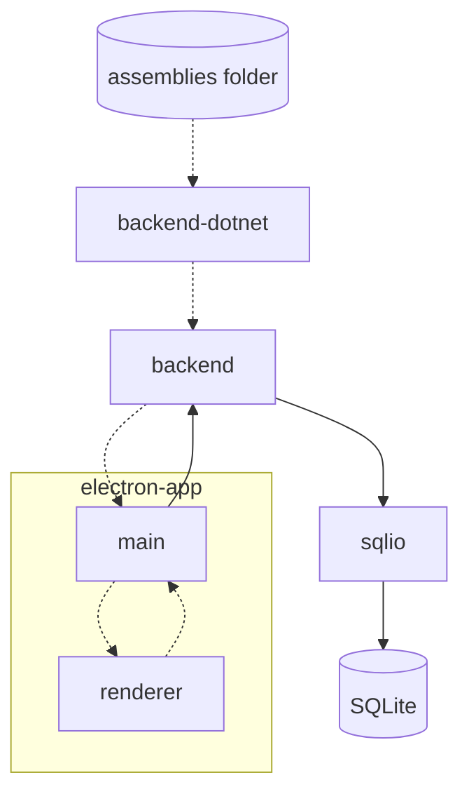

# Interfaces

How the packages are linked, and what the API between them is. For what each package is for, see
`PACKAGES.md`; for what flows across these links, see `DATA-FLOW.md`.

## The packages and their links

Solid edges are a compile-time import. Dashed edges are run-time only.

Three things a diagram cannot show:

- **`backend` is not a package.** It has no `package.json`; each front end compiles its source tree in
  through `tsconfig` aliases, which is why there is no npm edge to draw.
- **`backend-dotnet` is a process.** It is built with `dotnet` and invoked as `Core.exe` over
  `electron-cgi`, so that edge is a conversation rather than a dependency.
- **The front end is below the backend at run time.** `electron-app`'s main process owns the paths — the
  database file, the native binding, `Core.exe` — and hands them over through `setPaths`, so the backend
  depends on the front end for _where things are_, and the front end on the backend for _what to show_.

## The contracts

The interfaces are five **contracts**: barrels over `packages/backend/contracts`, re-exported from
`packages/backend/src/contracts-*.ts` and reached through the `backend-*` aliases — `api`, `app`, `ui`,
`config` and `custom`.

They are layered, and the layering is acyclic: `dotnet` and `config` depend on nothing, `ui` on those two,
and `app` on `ui` and `config`. Nothing enforces it, so it is a rule to keep rather than a property of the
build.

- **`contracts/dotnet`** — the shapes produced by `Core.exe`: reflected data, and ids.
- **`contracts/config`** — the settings model: `AppOptions`, `DotnetOptions`, `CustomOptions`, their union
  `AnyOptions`, and a schema per kind — the shape VS Code describes an extension's settings in, which is
  what the options panel renders.
- **`contracts/ui`** — what the UI displays: nodes, edges, image, node ids, node state. It depends on
  `dotnet` and `config` because an event carries the options.
- **`contracts/app`** — the application API: `DataSource`, `OpenDataSource`, `AppConfig`, `Paths`,
  `PresenterApi`, `ShowProgress`, menu.

`contracts-app.ts` re-exports with `export type *`, so `backend-app` carries types and no values; the other
three use `export *` and carry both. That is why the renderer can hold an `AnyView` but cannot call the
backend to ask for one.

## The API between each pair

Each row is an **edge**, not a contract: several consumers import the same barrel, so there are more edges
than there are interfaces. The folder named is the one that declares the interface, not the consumer.

| pair                                          | the folder that declares the interface                                                    |
| --------------------------------------------- | ----------------------------------------------------------------------------------------- |
| `electron-app` → `backend` (`backend-api`)    | [`backend/src/`](../../packages/backend/src/)                                             |
| `electron-app` → `backend` (`backend-app`)    | [`backend/contracts/app/`](../../packages/backend/contracts/app/)                         |
| `electron-app` → `backend` (`backend-ui`)     | [`backend/contracts/ui/`](../../packages/backend/contracts/ui/)                           |
| `electron-app` → `backend` (`backend-config`) | [`backend/contracts/config/`](../../packages/backend/contracts/config/)                   |
| `electron-app-test` → `backend`               | [`backend/contracts/ui/`](../../packages/backend/contracts/ui/), [`…/config/`](../../packages/backend/contracts/config/) |
| `vscode-ext` → `backend`                      | [`backend/src/`](../../packages/backend/src/), [`backend/contracts/ui/`](../../packages/backend/contracts/ui/) |
| `backend` → `sqlio`                           | [`sqlio/src/`](../../packages/sqlio/src/)                                                 |
| `backend` → `backend-dotnet`                  | [`backend/src/dotnetFetch/`](../../packages/backend/src/dotnetFetch/), [`backend/contracts/dotnet/`](../../packages/backend/contracts/dotnet/) |
| `backend-test` → `backend`                    | all of the above, plus `sut/*` → [`backend/src/`](../../packages/backend/src/)            |

## vscode-ext

The VS Code extension imports the same backend — `backend-api` and `backend-ui` — and reads the same
database, but it is a work in progress: it does not yet load `Core.exe` at run time, so it cannot build a
model of its own. It is left out of the diagram above for that reason.

